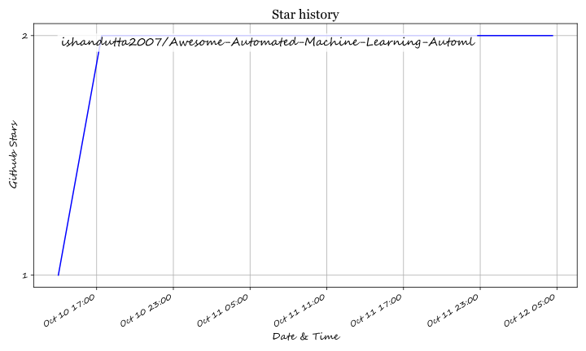

# Awesome-Automated-Machine-Learning-Automl

# Awesome-Automated-Machine-Learning-Automl

# Awesome-Automated-Machine-Learning-Automl 🤖 📊

  

  
  
  
  
  
  

---

## 🌟 Top Automated Machine Learning (AutoML) Ecosystem

**Curated List of Commercial AutoML Platforms & Open-Source Machine Learning Automation Frameworks**  
*Focused on Automated Feature Engineering, Hyperparameter Optimization, Neural Architecture Search, Model Selection & Self-Hosted AutoML Pipelines*

**Last updated: October 2026** 📅

---

### 📌 Overview & SEO Summary
Welcome to the ultimate curated directory of **automated machine learning platforms**, **open-source AutoML frameworks**, and **hyperparameter optimization tools**. Whether you are looking for enterprise-grade commercial solutions (such as *DataRobot*, *Google Cloud AutoML*, and *H2O Driverless AI*), or self-hostable open-source alternatives (like *AutoGluon*, *TPOT*, and *MLJAR*), this list covers category leaders, automated feature engineering, and privacy-respecting machine learning automation.

**Key Market Context:**
- **TPOT** is the **most widely adopted open-source AutoML tool**, with **10,048 GitHub stars**, using **genetic programming** to optimize machine learning pipelines automatically .
- **MLJAR AutoML** (mljar-supervised) is a **practical open-source framework for tabular data**, with **MIT licensing** and a **user-friendly graphical interface** in MLJAR Studio .
- **AutoGluon** from AWS Labs provides **multi-layer stacking** and **automated model selection** with a simple three-line API.
- **H2O Driverless AI** is **available as a BYOL AMI on AWS Marketplace**, with infrastructure costs around **$3.06/hr on p3.2xlarge** and a **monthly estimate of $2,203/month** .
- **DataRobot** annual contracts range from **$100,000–$250,000 for small deployments** (10–25 users) to **$600,000+ for enterprise** (75+ users), with **hidden costs including compute overages (15–30% add-on), professional services (tens to hundreds of thousands), and annual support increases of 3–5%** .
- **Akki**o has **pivoted to enterprise-only**, removing its **$49 and $99 self-serve tiers** in July 2026 and selling exclusively through custom quotes to media holding companies like **Havas and Horizon Media** .
- **PyCaret** is the **most accessible low-code AutoML library**, with **prep() and compare_models()** wrapping 30+ algorithms into a single workflow.

---

## 📑 Table of Contents
- [🏢 SaaS & Commercial Platforms](#-saas--commercial-platforms)
- [🔓 Open-Source GitHub Projects](#-open-source-github-projects)
- [🛠️ How to Contribute](#%EF%B8%8F-how-to-contribute)
- [📊 Star History](#-star-history)
- [🤝 Support & Sponsorship](#-support--sponsorship)
- [⚠️ Disclaimer](#%EF%B8%8F-disclaimer)

---

## 🏢 SaaS / Commercial Platforms

The AutoML market spans **hyperscaler-native platforms** (Google Cloud AutoML, SageMaker Autopilot, Azure Automated ML) that provide **managed ML pipelines with pay-as-you-go pricing**, **enterprise AutoML suites** (DataRobot, H2O Driverless AI, Dataiku) that offer **full lifecycle automation with governance**, and **specialized predictive platforms** (Pecan AI, Akkio) that focus on **business-user-friendly predictions for specific use cases**. **DataRobot** uses **custom enterprise pricing** with **$100K–$250K+ annual contracts** . **H2O Driverless AI** is **available as BYOL on AWS Marketplace** at **$3.06/hr infrastructure cost** . **Azure Automated ML** carries **no surcharge beyond compute costs** .

| SaaS / Commercial Platform | Company / Owner | Valuation / Market Cap | Standard Edition Starting Price | Free Tier / Free Trial Limits | Description |
| :--- | :--- | :--- | :--- | :--- | :--- |
| **[Google Cloud AutoML](https://cloud.google.com/automl)** 🌐 | Google (Alphabet) | ~$2.0 Trillion | **Pay-per-use** (training hours + prediction) | **$300 free credits** for new customers | **GCP-native AutoML** — **Vertex AI** provides AutoML for tabular, image, text, and video data. **No-code model training** with custom data. **Deep GCP integration** . |
| **[AWS SageMaker Autopilot](https://aws.amazon.com/sagemaker/autopilot/)** ☁️ | Amazon | ~$2.0 Trillion | **Pay-as-you-go** (instance hours + storage) | **Free tier: 250 hours of ml.t3.medium notebook for 2 months**  | **AWS-native AutoML** — **Automatically builds, trains, and tunes models** . **Part of SageMaker Data Wrangler and Pipelines** . **Managed infrastructure scaling** . |
| **[Microsoft Azure Automated ML](https://azure.microsoft.com/en-us/products/machine-learning/automatedml/)** 🔷 | Microsoft | ~$3.90 Trillion | **Compute cost only** (no surcharge)  | **Free tier: limited credits** | **Azure-native AutoML** — **No surcharge beyond underlying compute** . **Classification, regression, forecasting, and computer vision** . **Azure ML studio integration** . |
| **[DataRobot](https://www.datarobot.com/)** 🎯 | DataRobot | ~$6 Billion | **$100K–$250K/year** (10–25 users)  | **No free tier**; demo required | **Enterprise AutoML platform** — **Full lifecycle automation from data prep to deployment** . **MLOps with monitoring, drift detection, and challenger models** . **Support fees 15–20% of license** . |
| **[H2O Driverless AI](https://h2o.ai/)** 🧠 | H2O.ai | ~$1 Billion | **BYOL AMI: ~$2,203/month** infrastructure on AWS  | **Free trial available** | **Automatic feature engineering and model selection** — **Driverless AI automates the entire ML pipeline** . **Available as BYOL on AWS Marketplace** . **GPU-optimized for speed** . |
| **[Dataiku](https://www.dataiku.com/)** 🟢 | Dataiku | ~$3.7 Billion | **Custom enterprise pricing**  | **Free trial available** | **Everyday AI platform** — **AutoML integrated with data preparation, visual ML, and MLOps** . **Team collaboration and governance** . |
| **[Pecan AI](https://www.pecan.ai/)** 📊 | Pecan AI | Private | **Starter: 2 prediction batches/month, 500M rows**  | **No free tier**; plan-based | **Predictive AI agent** — **Automates data prep, complex modeling, and answers questions in plain English** . **Schedule delivery to database, data warehouse, or CRM** . |
| **[Akkio](https://www.akkio.com/)** 🔴 | Akkio | Private | **Enterprise-only** (custom quote)  | **No self-serve**; contact sales | **AI analytics platform (enterprise)** — **Pivoted to enterprise-only in July 2026**, removing $49/$99 tiers . **Serves media holding companies (Havas, Horizon Media)** . |
| **[RapidMiner](https://rapidminer.com/)** 🟠 | RapidMiner | Private | **$10/year** (starting, quote-based)  | **Free trial available** | **Data science platform** — **Visual workflow design with AutoML** . **Annual and pay-as-you-go billing** . |
| **[Salesforce Einstein Discovery](https://www.salesforce.com/)** ☁️ | Salesforce | ~$250 Billion | **Included with CRM Analytics**  | **Free with Salesforce subscription** | **CRM-native AutoML** — **Automated insights and predictions for Salesforce data** . **Einstein Discovery models for reports** . |

---

## 🔓 Open-Source GitHub Projects

*Sorted by GitHub_Stars_Count (Descending)* 🌟

- **[AutoGluon](https://github.com/autogluon/autogluon)**   
  **AutoML for Text, Image, and Tabular Data**, Apache-2.0 licensed. **AWS Labs' flagship AutoML framework** — **multi-layer stacking and automated model selection** . **Three-line API** for tabular, image, text, and time series . **State-of-the-art performance** on AutoML benchmarks . **The most accessible production-ready open-source AutoML** . 🚀

- **[TPOT](https://github.com/EpistasisLab/tpot)**   
  **Automated Machine Learning with Genetic Programming**, LGPL-3.0 licensed. **10,048 GitHub stars**  — **the most widely adopted open-source AutoML tool** . **Genetic programming optimizes ML pipelines** automatically . **Exports optimized pipeline as standalone Python code** . **scikit-learn compatible** . 🧬

- **[PyCaret](https://github.com/pycaret/pycaret)**   
  **An open-source, low-code machine learning library in Python**, MIT licensed. **The most accessible low-code AutoML library** — **`prep()` and `compare_models()` wrap 30+ algorithms into a single workflow** . **Classification, regression, clustering, anomaly detection, NLP, and time series** . **The fastest path from data to model** . ⚡

- **[MLJAR AutoML](https://github.com/mljar/mljar-supervised)**   
  **Automated Machine Learning framework for tabular data**, MIT licensed. **Practical open-source framework** — **automates the entire ML pipeline from preprocessing to hyperparameter tuning** . **Available as Python package and with GUI in MLJAR Studio** . **Reproducible reports and model explanations** . 🎯

- **[Auto-sklearn](https://github.com/automl/auto-sklearn)**   
  **Automated Machine Learning toolkit**, BSD-3-Clause licensed. **scikit-learn replacement for AutoML** — **automates algorithm selection and hyperparameter tuning** . **Meta-learning and ensemble construction** . **The original AutoML for Python** . 🏛️

- **[SMAC3](https://github.com/automl/SMAC3)**   
  **Sequential Model-based Algorithm Configuration**, BSD-3-Clause licensed. **Versatile Bayesian Optimization package for hyperparameter optimization** . **Used by Auto-sklearn and many AutoML frameworks** . **The foundation of modern HPO** . ⚙️

- **[LightAutoML](https://github.com/sb-ai-lab/LightAutoML)**   
  **Fast and customizable framework for automatic ML model creation**, Apache-2.0 licensed. **Sberbank AI Lab's AutoML** — **optimized for speed and production** . **Lightweight and efficient** . ⚡

- **[FEDOT](https://github.com/aimclub/FEDOT)**   
  **Automated modeling and machine learning framework**, BSD-3-Clause licensed. **Evolutionary AutoML** — **automatically composes pipelines** . **Handles complex ML problems with evolutionary algorithms** . 🧬

- **[Auto_ViML](https://github.com/AutoViML/Auto_ViML)**   
  **Automatically Build Multiple ML Models with a Single Line of Code**, Apache-2.0 licensed. **The most accessible AutoML for beginners** . **One-line model building** . 🚀

- **[mindware](https://github.com/thomas-young-2013/mindware)**   
  **Efficient open-source AutoML system for automating ML lifecycle**, open-source. **Feature engineering, neural architecture search, and hyperparameter tuning** . **Full lifecycle automation** . 🛠️

- **[Hyperactive](https://github.com/SimonBlanke/Hyperactive)**   
  **Optimization and data collection toolbox for convenient and fast prototyping**, MIT licensed. **Hyperparameter optimization and model selection** . **Streamlined experimentation** . 🔬

- **[SapientML](https://github.com/sapientml/sapientml)**   
  **Generative AutoML for Tabular Data**, Apache-2.0 licensed. **Generates pipelines from dataset characteristics** . **AI-powered pipeline generation** . 🤖

- **[AutoQuant](https://github.com/AdrianAntico/AutoQuant)**   
  **R package for automation of machine learning, forecasting, model evaluation, and model interpretation**, open-source. **Comprehensive AutoML for R** . **Forecasting and interpretation built-in** . 📈

- **[archai](https://github.com/microsoft/archai)**   
  **Accelerate Neural Architecture Search (NAS) through fast, reproducible and modular research**, MIT licensed. **Microsoft's NAS research framework** . **Fast and reproducible NAS experiments** . 🏗️

- **[autoalbument](https://github.com/albumentations-team/autoalbument)**   
  **AutoML for image augmentation**, MIT licensed. **Uses Faster AutoAugment algorithm to find optimal augmentation policies** . **The standard for automated image augmentation** . 🖼️

- **[autofeat](https://github.com/cod3licious/autofeat)**   
  **Linear Prediction Model with Automated Feature Engineering and Selection Capabilities**, MIT licensed. **Automated feature engineering** . **Linear model with automatic feature selection** . 🔧

- **[EvolutionaryForest](https://github.com/hengzhe-zhang/EvolutionaryForest)**   
  **Open source python library for automated feature engineering based on Genetic Programming**, open-source. **Genetic programming for feature engineering** . **The most advanced open-source feature engineering library** . 🌲

- **[Trane](https://github.com/trane-dev/Trane)**   
  **An open source python library for automated prediction engineering**, open-source. **Automated prediction engineering** . **The most specialized open-source AutoML for prediction engineering** . 🎯

- **[a2ml](https://github.com/augerai/a2ml)**   
  **Common API for all second-gen AutoML APIs**, Apache-2.0 licensed. **Unified interface for Google Cloud AutoML and Azure AutoML** . **The standard for multi-cloud AutoML abstraction** . ☁️

---

## 🛠️ How to Contribute

Contributions are welcome! Follow these steps to submit new AutoML platforms or open-source machine learning automation software:

1. 🍴 **Fork** the repository.
2. 📝 **Add/edit** entries in `README.md` maintaining table/list structure and formatting.
3. 🔗 Include project title, official website/GitHub link, exact Stars_Count, license, and brief description.
4. 🚀 Submit a **Pull Request** with a descriptive summary of your changes.

---

## 📊 Star History

---

## 🤝 Support & Sponsorship

If you find this AutoML repository useful, please consider supporting the project:

- ⭐ **Star** this repository to increase visibility!
- 🔀 **Fork** and share with fellow data scientists, ML engineers, and open-source advocates.
- ☕ **Sponsor & Buy Me a Coffee**: Support ongoing open-source curation via the [GitHub Sponsor Dashboard](https://github.com/sponsors/ishandutta2007).

---

## ⚠️ Disclaimer

- This is a **community-curated** list — not exhaustive and not an endorsement. ℹ️
- **DataRobot annual contracts range from $100K–$250K for small deployments** to **$600K+ for enterprise**, with **hidden costs including compute overages (15–30% add-on), professional services (tens to hundreds of thousands), and annual support increases of 3–5%** . **Akki**o has **pivoted to enterprise-only**, removing its **$49 and $99 self-serve tiers in July 2026** .
- **H2O Driverless AI is available as a BYOL AMI on AWS Marketplace** — **infrastructure costs around $3.06/hr on p3.2xlarge** with a **monthly estimate of $2,203/month** . **Azure Automated ML carries no surcharge beyond compute costs** .
- **TPOT is the most widely adopted open-source AutoML tool** with **10,048 GitHub stars** . **PyCaret is the most accessible low-code AutoML library** with **`prep()` and `compare_models()` wrapping 30+ algorithms into a single workflow** . **MLJAR AutoML is the most practical open-source framework for tabular data** with **MIT licensing and GUI support** .
- **Open-source AutoML tools are not turnkey** — **AutoGluon requires Python and sufficient compute** . **TPOT requires genetic programming knowledge for advanced use** . **SMAC3 requires Bayesian optimization expertise** . **Always validate model performance, fairness, and explainability with a proof-of-concept** before production deployment. 🤖

---

  <b>Made with ❤️ for data scientists, ML engineers, and open-source AutoML advocates.</b>

## ⭐ Star History

<a href="https://star-history.com/#ishandutta2007/Awesome-Automated-Machine-Learning-Automl&Timeline" align="center">
  <picture>
    <source media="(prefers-color-scheme: dark)" srcset="assets/ishandutta2007_Awesome-Automated-Machine-Learning-Automl_growth.svg">
    
  </picture>
</a>
